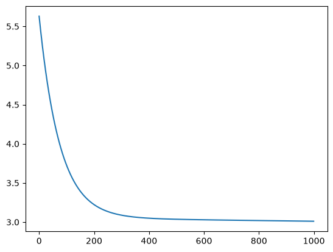

# Build Your Own Brain: Linear Regression from Scratch

Linear Regression implemented from scratch with **NumPy** and trained with **Gradient Descent** on the **California Housing** dataset. I studied the effect of feature scaling and learning rate, then compared my model with `sklearn.linear_model.LinearRegression` using MSE, MAE and R².

## Dataset

- **California Housing** (1990 US census), loaded with `sklearn.datasets.fetch_california_housing`
- 20,640 neighbourhoods (block groups), 8 features: `MedInc`, `HouseAge`, `AveRooms`, `AveBedrms`, `Population`, `AveOccup`, `Latitude`, `Longitude`
- Target: median house value, in units of $100,000
- Split: 80% train (16,512) / 20% test (4,128), `random_state=42`

## How it works

The model predicts `ŷ = Xw + b` and is trained by minimising the mean squared error:

```
MSE = (1/n) Σ (ŷ − y)²
∂MSE/∂w = (2/n) Xᵀ(ŷ − y)
∂MSE/∂b = (2/n) Σ (ŷ − y)
```

Each iteration computes the predictions, measures the error, and moves the weights a small step (the learning rate) in the direction that reduces it. Features are standardised with `(x − mean) / std`, using **training-set statistics only** so that no test information leaks in.

## Project files

| File | Description |
|---|---|
| `task6.ipynb` | Full implementation, experiments, graphs and conclusions |
| `output.png` | Learning rate experiment graph |
| `README.md` | This file |

## Results

| Model | MSE | MAE | R² |
|---|---|---|---|
| My NumPy Gradient Descent | 0.5559 | 0.5332 | 0.5758 |
| sklearn LinearRegression | 0.5559 | 0.5332 | 0.5758 |

The learned weights and bias also matched sklearn's to six decimal places.

| Feature | Weight (scaled data) |
|---|---|
| MedInc | 0.8544 |
| HouseAge | 0.1225 |
| AveRooms | -0.2944 |
| AveBedrms | 0.3393 |
| Population | -0.0023 |
| AveOccup | -0.0408 |
| Latitude | -0.8969 |
| Longitude | -0.8698 |
| Bias | 2.0719 |

## Experiments

### 1. Feature scaling
Features sit on very different scales (`Population` is in the thousands, `MedInc` is 1 to 10). Without scaling, a large learning rate makes the loss explode, so only a tiny one is usable, and the small-scale features then barely learn. After standardisation, one learning rate works for every feature and training converges quickly.

### 2. Learning rate


- `lr = 0.001`: stable but very slow
- `lr = 0.01`: steady, still converging after 100 iterations
- `lr = 0.1` and `0.3`: fast convergence, flattening at an MSE of about 0.52
- `lr = 1.5`: **diverges**; each step overshoots the minimum and the loss grows exponentially

### 3. Visualising the learning process
Fitting a single feature (`MedInc`) shows the line start flat, tilt gradually, and settle through the data. By about 50 iterations it has essentially converged.

## Why my model matches sklearn

sklearn solves least squares **directly** (a closed-form solution), while gradient descent reaches the same answer **iteratively**. Because the MSE loss for linear regression is convex, with a single global minimum, both end at the same solution. The advantages of the library are exactness, speed, numerical stability and no hyperparameters to tune. Gradient descent is still useful for huge datasets and for models without a closed-form solution, such as neural networks.

## Limitations

- R² of about 0.58 means a straight-line model explains only part of the variation. Location effects are non-linear, and house values are capped at $500,000 in this dataset.
- `AveRooms` and `AveBedrms` are strongly correlated (multicollinearity), so their individual weights are hard to interpret.

## How to run

```bash
pip install numpy pandas matplotlib scikit-learn jupyter ipykernel
jupyter notebook task6.ipynb
```

Run all cells from top to bottom.

## Tools

Python 3.12, NumPy, pandas, Matplotlib, scikit-learn, GitHub Codespaces.
